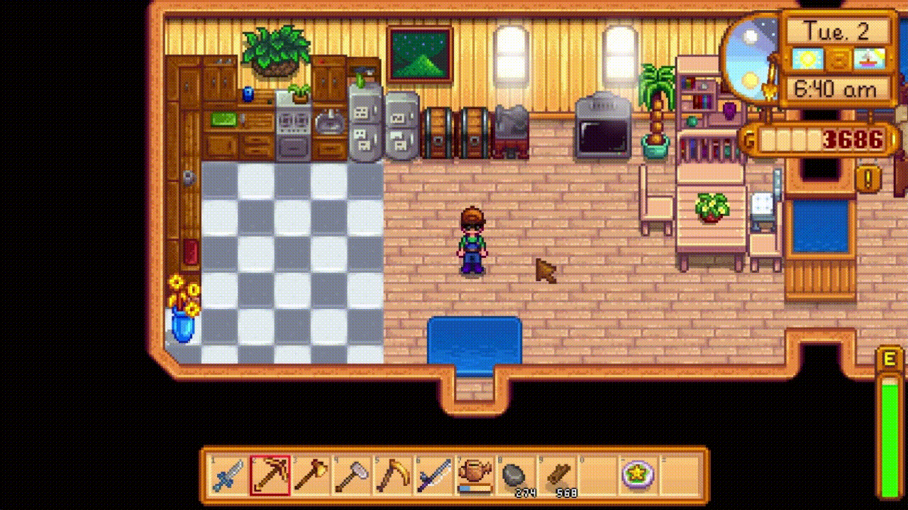

# Static Inventory

## About this mod

Keeps your main inventory in a static list in every menu screen. While still allowing the ability to shift the toolbar to see the different rows while in-game.

## Description

**Now updated for Stardew Valley 1.6 & SMAPI 4!**

**Static Inventory** keeps your inventory in the same order throughout all of the menus. While still being able to shift your toolbar around in-game.

Love the feature of being able to swap your toolbar to see & use different rows in your inventory? Hate the fact that it also shifts around your actual inventory in the menus? Look no further! This mod will keep your inventory static while you are swapping your toolbar as your heart desires!

### Install
* Install the latest version of SMAPI.
* Unzip the mod folder into Stardew Valley/Mods.
* Run the game using SMAPI.

### Compatibility

This mod may be incompatible with other mods that modify the toolbar or inventory. It has not been tested against other mods, so please report any issues you find.
